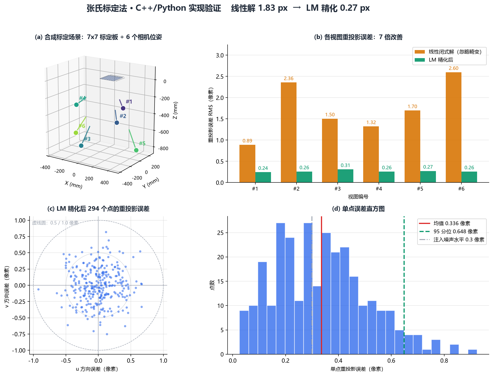

# camera-calibration-cpp

**张氏标定法（Zhang's Camera Calibration）纯 C++ 实现 —— 不依赖 OpenCV / Eigen**

[](https://github.com/edisondragon/camera-calibration-cpp/actions/workflows/ci.yml)
[](https://en.cppreference.com/w/cpp/17)
[](LICENSE)

一个把张氏标定的**每一步数学都写在代码里**的实现：DLT 求单应、Hartley 归一化、
绝对二次曲线约束、闭式反解内参、外参正交化、径向畸变最小二乘、
Levenberg-Marquardt 精化（含解析雅可比）。

代码结构严格对应 [张氏标定法-完整公式与推导.md](docs/张氏标定法-完整公式与推导.md) 的章节，
每个函数都在注释里标了对应章节号，可以对照着读。

---

## 效果



上图完全由 `tools/make_figures.py` 实际运行生成，数字没有手填。

在 **0.3 像素噪声 + 真实径向畸变（k1 = −0.10）** 的合成数据上：

| | alpha | beta | u0 | v0 | k1 | 重投影 RMS |
|---|---|---|---|---|---|---|
| 真值 | 1200 | 1150 | 640 | 480 | −0.100 | — |
| 线性闭式解 | 1177.79 | 1123.44 | 693.91 | 537.12 | 假设为 0 | 1.826 px |
| **LM 精化后** | **1199.79** | **1148.88** | **641.80** | **477.33** | **−0.1031** | **0.268 px** |

线性闭式解**忽略了畸变**，所以内参被带偏（u0 差了 54 像素）；
LM 把畸变、内参、外参一起优化后，内参误差降到 1 像素量级，
重投影误差 **6.8 倍改善**，且已低于 0.3 像素的噪声下限。

---

## 为什么不用 OpenCV

用 OpenCV 三行就能标定完：

```cpp
cv::calibrateCamera(objectPoints, imagePoints, imageSize, K, dist, rvecs, tvecs);
```

但你看不到里面发生了什么。这个项目让每一步数学都暴露在代码里：

| 数学步骤 | 代码位置 |
|---|---|
| DLT + Hartley 归一化求单应矩阵 | `computeHomography` |
| v(ij) 的构造、V·b = 0 | `vij`、`calibrate` |
| 从 B 矩阵闭式反解内参 | `KfromB` |
| 外参提取 + SVD 正交化 | `extrinsicsFromH`、`nearestRotation` |
| 径向畸变线性最小二乘 | `estimateDistortion` |
| LM 精化 + 解析雅可比四个 Block | `refineLM`、`calcJacobian` |

---

## 快速开始

```bash
cmake -B build -DCMAKE_BUILD_TYPE=Release
cmake --build build
./bin/zhang_calib data/synthetic.txt
```

生成的可执行文件在 `bin/zhang_calib`（Windows 下加 `.exe`）。

不用 CMake 也行：

```bash
# Linux / macOS / MinGW
g++ -O2 -std=c++17 -Isrc src/main.cpp src/zhang.cpp -o zhang_calib

# MSVC
cl /std:c++17 /EHsc /O2 /Isrc src\main.cpp src\zhang.cpp /Fe:zhang_calib.exe
```

### 数据文件格式

```
# 以 # 开头的是注释，自动跳过
5 49                          <-- 视图数  每视图点数
0.0   0.0   815.3  297.1      <-- X   Y   u   v
30.0  0.0   851.6  299.4
...
```

- `X Y` 是角点在标定板上的坐标（mm，板平面为 Z = 0）
- `u v` 是检测到的像素坐标
- 所有点按视图顺序排列

### 选项

```bash
./bin/zhang_calib data/synthetic.txt --no-refine   # 跳过 LM，只看线性闭式解
```

---

## 验证

这个项目有**三层独立的验证**，CI 里每次提交都会全跑一遍。

### 第一层：有限差分检验解析雅可比

这是最硬的一层。LM 能不能收敛完全取决于雅可比对不对，
所以不靠"看起来能跑"，而是直接拿**中心差分数值导数逐列比对**：

```bash
python tools/verify_jacobian.py
```

```
 检验 1  解析雅可比 vs 中心差分数值导数
   参数个数      : 25  (7 内参+畸变 + 3 图 x 6)
   雅可比尺寸    : (294, 25)
   最大相对误差  : 1.624e-07
 [OK] 雅可比与有限差分一致（相对误差 < 1e-6）
```

这个检验抓出过两个真 bug，详见下面「踩过的坑」。

### 第二层：Python 参考实现

`tools/zhang_reference.py` 是 `zhang.cpp` 的逐行镜像，把整个算法重写了一遍：

```bash
python tools/zhang_reference.py
```

无噪声数据的实测输出：

```
[验证 0] Jacobi 特征分解 vs numpy.linalg.eigh
   最大绝对误差     : 4.441e-15
[验证 2] 线性闭式解
   绝对误差:  alpha 2.728e-12   beta 2.728e-12
              gamma 2.544e-13   u0 2.501e-12   v0 5.684e-13
[验证 3] 外参正交性
   第 1 张: max|R^T R - I| = 4.219e-16 ,  det(R) = 1.000000
[验证 4] 重投影误差 RMS = 1.958e-13 像素
 结论: 算法正确 —— 内参完全复原，重投影误差为机器精度
```

### 第三层：C++ 与 Python 交叉比对

C++ 和 Python 是各写各的，**两者必须算出同一个内参矩阵**。
任何一边公式写错都会在这里暴露：

```bash
python tools/check_cpp_output.py ./bin/zhang_calib data/synthetic.txt
```

```
  C++     RMS = 0.0000000000e+00
  Python  RMS = 3.166665e-11
  内参最大绝对差 = 0.000e+00
 [OK] C++ 与 Python 的 K 一致
```

---

## 踩过的坑

这些是"照着论文写能跑出结果、但结果是错的"的地方。前四个是算法本身的符号/歧义问题，
后两个是**用有限差分才抓出来的**真 bug。

### 坑 1：b 的符号必须修正

`smallestEigenVector` 返回单位向量，符号是任意的。
如果 b 整体为负，B 就是负定矩阵，`lambda = B33 - ...` 会算出负数，开根号直接 NaN。

```cpp
if (b[0] < 0.0) for (double& v : b) v = -v;   // B 必须正定，所以 B11 > 0
```

### 坑 2：H 的符号歧义

`H` 和 `-H` 给出**完全相同的投影**，但解出的位姿不同：

```
   H  ->  ( R,                 t  )
  -H  ->  ( R * diag(-1,-1,1), -t )     <- 投影一样，但板跑到相机后面了
```

不管的话约有一半视图会解出负深度。代码统一选"板在相机前方"：

```cpp
if (t[2] < 0.0) {
    R.at(i,0) = -R.at(i,0);   // R <- R * diag(-1,-1,1)
    R.at(i,1) = -R.at(i,1);
    for (double& v : t) v = -v;
}
```

### 坑 3：正交化必须处理 det = −1

把 `Q = [r1 r2 r3]` 投影到最近的旋转矩阵用的是 `R = Q (QᵀQ)^(−1/2)`，
但若 `det(Q) < 0`，得到的 R 行列式是 −1（是镜像不是旋转）。
代码在求 `(QᵀQ)^(−1/2)` 时对最后一个特征方向翻符号来修正。

### 坑 4：只有 2 张图时需要补约束

b 有 6 个未知数、去掉整体尺度后是 5 个。2 张图只给 4 个方程，欠定 1 个，
需要补 `skew = 0` 即 `B12 = 0`：

```cpp
if (nv == 2) V.at(4, 1) = 1.0;
```

### 坑 5 ⚠️ 旋转雅可比里的 t 多减了一次

> **这个是有限差分抓出来的。** 当时的症状是"程序不报错、残差也不涨，但参数一动不动，
> 畸变系数估出来永远是 0"，非常隐蔽。

旋转扰动是左乘：`R → rodrigues(dw) · R`，于是

```
Xc' = (I + [dw]×)(R·X) + t  =  Xc + dw × (R·X)
```

所以 `[dw]×` 作用在 **`R·X`** 上 —— 而 `R·X = Xc − t`。
**平移量 t 不随旋转变化**，写成 `Xc` 就多带了一个 `t`。

因为 `t` 恒不为零，这个错误会让旋转那三列**全部偏掉**：

```cpp
// 错误写法
const double dXdw[3][3] = {
    {  0.0,   Zc,  -Xc[1] },      // 用了 Xc
    { -Zc,   0.0,   Xc[0] },
    {  Xc[1], -Xc[0], 0.0 }
};

// 正确写法
const double vrot[3] = { Xc[0] - t[i][0],
                         Xc[1] - t[i][1],
                         Xc[2] - t[i][2] };      // 就是 R*X
const double dXdw[3][3] = {
    {  0.0,    vrot[2], -vrot[1] },
    { -vrot[2], 0.0,     vrot[0] },
    {  vrot[1], -vrot[0], 0.0    }
};
```

改正前后，有限差分给出的最大相对误差从 **1253** 降到 **1.6e−07**。

### 坑 6 ⚠️ LM 的两套阻尼约定混用了

LM 有两种常见写法，**初值取法完全不同**：

| 约定 | 方程 | λ 量纲 | 初值 |
|---|---|---|---|
| **Marquardt** | (A + λ·diag(A)) δ = −g | 无量纲 | `1e-3` |
| **Levenberg** | (A + λ·I) δ = −g | 与 A 同量纲 | `1e-3 · max(diag A)` |

用 `diag(A)` 缩放却按 Levenberg 的方式初始化 λ，等于**把 `diag(A)` 乘了两次**。
本项目的 `diag(A)` 量级在 1e14 附近，于是阻尼项变成 1e25，步长恒为零：

```cpp
// 错误写法
if (iter == 0) mu = 1e-3 * (maxDiag > 0 ? maxDiag : 1.0);   // 混用了两套约定

// 正确写法：用 Marquardt 约定，mu 就是无量纲的 1e-3
double mu = 1e-3;
```

这个坑的症状和坑 5 很像：**不报错，但参数不动**。

---

## 目录结构

```
camera-calibration-cpp/
├── CMakeLists.txt
├── LICENSE
├── README.md
├── .github/workflows/ci.yml        三平台编译 + 三层验证
├── src/
│   ├── linalg.h                    极简线性代数（Jacobi 特征分解、Cholesky、SVD 辅助）
│   ├── zhang.h                     接口定义
│   ├── zhang.cpp                   标定算法主体
│   └── main.cpp                    命令行入口
├── opencv/
│   └── calibrate_opencv.cpp        OpenCV 版对照实现（含棋盘格角点检测 + 去畸变）
├── tools/
│   ├── zhang_reference.py          Python 参考实现（算法验证 + 生成测试数据）
│   ├── verify_jacobian.py          有限差分检验解析雅可比
│   ├── check_cpp_output.py         C++ 与 Python 交叉比对
│   └── make_figures.py             生成 README 配图
├── docs/
│   ├── 张氏标定法-完整公式与推导.md     从零推导的配套讲义
│   ├── 三维重建与点云-主流项目与学习资源.md
│   └── images/                     配图（由 make_figures.py 生成）
└── data/
    └── synthetic.txt               合成测试数据（5 视图 × 49 点）
```

---

## 局限性

**这个项目不含角点检测。** 角点检测（Harris、Shi-Tomasi、亚像素精化）
本身是另一个大话题，和标定算法是两件事。

所以它**不能直接吃照片**。要处理真实照片，有三条路：

### 路线 A：用 OpenCV 版本（推荐）

`opencv/calibrate_opencv.cpp` 包含完整的角点检测 + 标定 + 去畸变：

```bash
g++ -O2 -std=c++17 opencv/calibrate_opencv.cpp -o calib_opencv \
    $(pkg-config --cflags --libs opencv4)
./calib_opencv ./images 9 6 25
```

参数依次是：图片目录、横排内角点数、竖排内角点数、方格边长（mm）。

### 路线 B：用 OpenCV 提角点，导出文本，喂给本项目

这样你可以用真实数据检验这份实现：用 `findChessboardCorners` + `cornerSubPix`
提角点，按 `data/synthetic.txt` 的格式写成文本。

### 路线 C：直接从别的标定工具导出角点

MATLAB 标定工具箱、ROS 的 `camera_calibration` 包等都能导出角点坐标。

---

## 想进一步改？

几个自然的练习方向：

1. **加切向畸变 p1, p2**
   在 `estimateDistortion` 里每点从 2 个未知数扩到 4 个；
   同时要在 `build_jacobian` 里补对应的偏导列，记得跑 `verify_jacobian.py`。

2. **给 LM 加 Schur 补**
   现在用稠密法方程解，参数量是 `7 + 6n`。10 张图是 67 个参数还能算，100 张就慢了。
   标准做法是利用"每张图的外参只出现在自己的残差里"这个块对角结构做 Schur 补，
   把问题降成只解 7 个内参。

3. **加更多畸变模型**
   鱼眼要用等距投影模型，不是多项式。

4. **加鲁棒核函数**
   现在是最小二乘，一个错误角点会污染整个解。换成 Huber 或 Cauchy 核更稳。

5. **加标定质量自动评估**
   检查各视图的覆盖范围、姿态多样性，给出"数据够不够好"的建议。

---

## 参考

- Z. Zhang, *A Flexible New Technique for Camera Calibration*, IEEE TPAMI, 2000.
  [PDF](https://www.microsoft.com/en-us/research/publication/a-flexible-new-technique-for-camera-calibration/)
- 配套中文讲义：[张氏标定法-完整公式与推导.md](docs/张氏标定法-完整公式与推导.md)

## License

[MIT](LICENSE)
